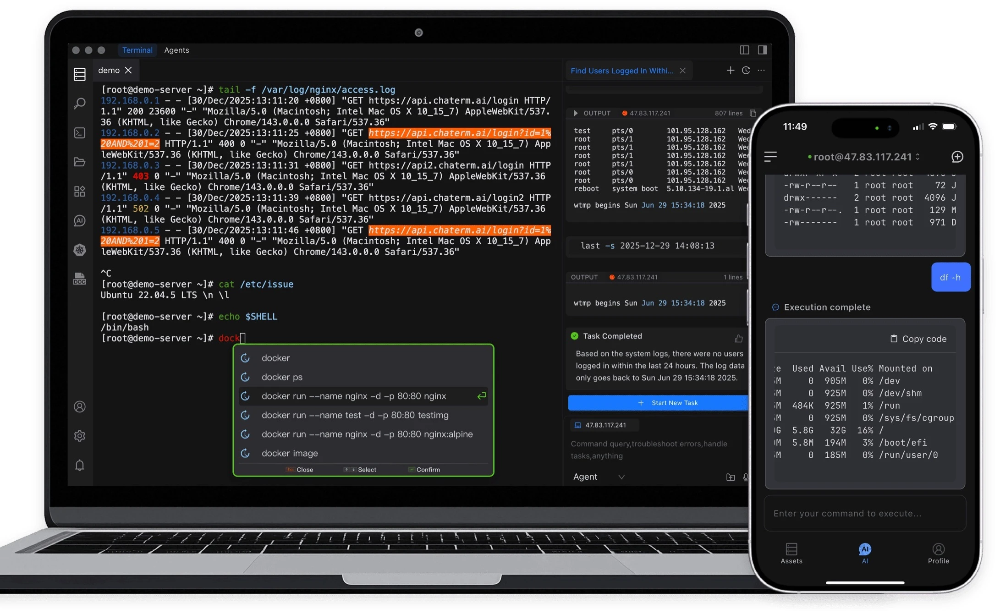
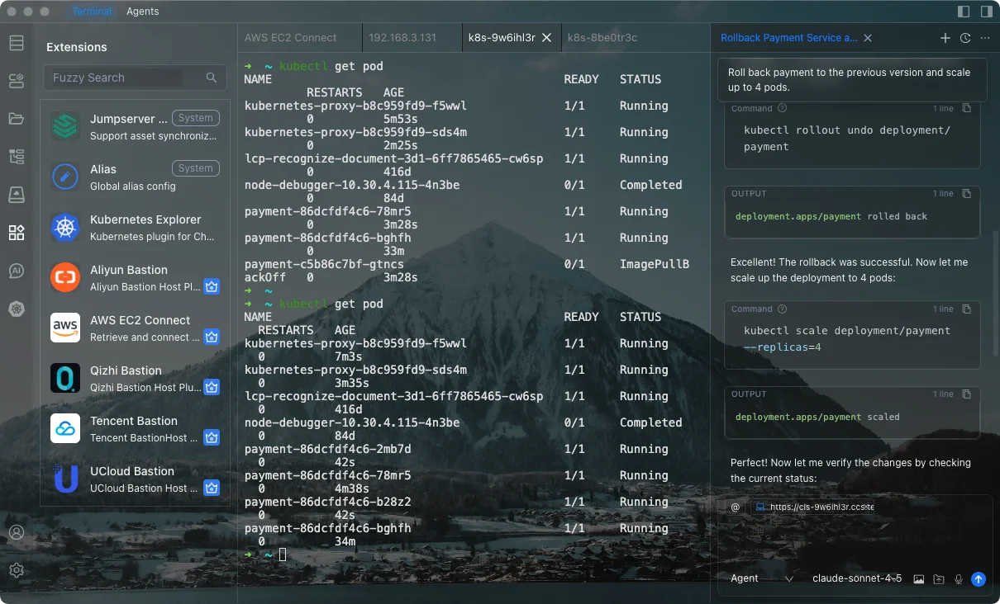

<div align="center">
  中文 / <a href="./README.md">English</a>
</div>
<br>

<p align="center">
  <a href="https://www.tbench.ai/leaderboard/terminal-bench/1.0"></a>
  <a href="https://aws.amazon.com/cn/blogs/china/chaterm-aws-kms-envelope-encryption-for-zero-trust-security-en/"></a>
  <a href="https://landscape.cncf.io/?item=provisioning--automation-configuration--chaterm"></a>
  <p align="center">
</p>

<p align="center">
  <a href="https://scorecard.dev/viewer/?uri=github.com/chaterm/Chaterm"></a>
  <a href="https://www.bestpractices.dev/projects/12617"></a>
  
  
  <a href="https://x.com/chaterm_ai"></a>
  <a href="https://deepwiki.com/chaterm/Chaterm"></a>
</p>

<p align="center">
  <a href="https://chaterm.ai/download/"></a>
  <a href="https://chaterm.ai/download/"></a>
  <a href="https://chaterm.ai/download/"></a>
  <a href="https://aws.amazon.com/marketplace/"></a>
  <p align="center">
</p>

## 目录

- [产品介绍](#产品介绍)
- [为什么选择 Chaterm](#为什么选择-chaterm)
- [核心特性](#核心特性)
- [🆕 新增功能：串口（Serial）连接](#-新增功能串口serial连接)
  - [功能亮点](#功能亮点)
  - [串口连接参数](#串口连接参数)
  - [AI 如何管理串口会话](#ai-如何管理串口会话)
- [开发指南](#开发指南)
  - [Install Electron](#install-electron)
  - [Install](#install)
  - [Development](#development)
  - [Build](#build)
- [Chaterm 参考文档](https://chaterm.cn/docs/)
- [Gold Sponsors](#gold-sponsors)
- [致谢](#致谢)
- [Contributors](#contributors)

# 产品介绍

Chaterm 是一款专为基础设施和云资源管理而构建的 AI 原生终端。它使工程师能够使用自然语言执行部署服务、故障排除和解决问题等复杂任务。

凭借其内置的专家级知识库和强大的代理推理能力，Chaterm 能够理解您的业务拓扑和运维目标。无需记忆复杂的命令、语法或参数，只需用自然语言描述您的任务目标，Chaterm 即可自主规划并执行跨多个主机或集群的复杂操作，包括代码构建、服务部署、故障诊断和自动回滚等关键流程。

Chaterm 依靠长期记忆和团队知识库，学习团队知识和用户习惯。它的目标是成为您智能的 DevOps 副驾驶，通过可重用的代理技能，帮助工程师更高效地完成日常任务。Chaterm 旨在降低不同技术栈带来的认知障碍，使每位开发人员都能快速获得高级 SRE 的运维经验和执行能力。





## 为什么选择 Chaterm

Chaterm 不仅仅是一个更智能的终端，它是一个基础设施代理。
有句话说，每个 Agent 都会时常失败，但 Chaterm 帮助你修复它。

- 🤖 从命令到执行 - 描述任务，让 AI 规划并执行

- 🌐 专为真实基础设施打造 - 服务器、Kubernetes 和多集群工作流

- 🔁 可复用的 Agent 技能 - 将经验转化为自动化

- 🧠 上下文感知智能 - 理解你的系统，而不仅仅是命令

- 🛡️ 安全可控 - 可审计、可审查、支持回滚

- 🔌 **串口直连** - 新增能力：直接用自然语言驱动交换机 / 路由器 / 嵌入式设备的 Console 口

## 核心特性

- 🤖 **AI 智能代理**

  Agent 能理解目标，自主规划，并跨越多台主机完成问题分析与根因定位，自动闭环完成复杂的流程处理。

  每一步操作均可审核与追溯，并支持快速日志回滚，让 AI 自动化在生产环境中更加安全可靠。

- 🧠 **智能命令推荐**

  结合用户习惯、本地记忆及当前服务器上下文，推荐最合适的命令，让终端输入更智能、更高效。

  可选本地回显会在高延迟 SSH 会话中立即渲染安全的交互式输入，并抵消确认后的远端回显。

  支持跨设备会话同步，并通过快捷命令与语音交互减少移动端输入成本，使远程运维更加流畅。

- 🧩 **用户知识库**

  支持导入技术手册、内部文档、脚本和白皮书，构建个人运维知识体系。

  Chaterm 能理解当前基础设施上下文并精准检索相关知识，辅助任务决策与执行。

- ⚡ **Agent Skill**

  将复杂运维流程封装为可复用的 AI 技能，实现结构化、可靠的自动化执行。

  帮助团队沉淀运维经验，使 AI 能安全、稳定地应用于真实生产环境。

- 🔌 **插件系统**

  通过插件扩展，实现对公有云服务器与 Kubernetes 的统一认证、动态授权与安全加密连接。

  提供更高效的资源访问体验，助力基础设施的集中化管理。

- 🗄️ **数据库工作区**

  支持连接 MySQL、PostgreSQL、SQLite 和 Oracle，完成 schema 浏览、数据查询、DDL 查看、表格行编辑以及数据库上下文 AI 辅助。

- 🔌 **串口（Serial / UART）连接** 🆕

  新增独立的连接类型，可直接对接串口设备，并由内嵌 AI Agent 通过自然语言驱动。详见下节。


# 🆕 新增功能：串口（Serial）连接

在原有 SSH / Telnet 之外，本分支新增了**串口（Serial / UART）连接类型**，并让 Chaterm 内嵌的 AI Agent 能够像管理 SSH 会话一样去**管理串口会话**——用自然语言向交换机、路由器、嵌入式设备发送命令并读取回显。

典型场景：设备 Console 口（如 Cisco / 华为交换机）、路由器、工控设备、IoT 网关、开发板（树莓派 / ESP32 等）的串口调试。

## 功能亮点

- **新增连接类型**：资产类型 `person-serial`，与 `person-ssh` / `person-telnet` 同级，可在资产库中统一管理与分组。
- **COM 端口自动检测**：新建串口资产时，串口头会调用本机串口枚举接口（`getSerialPorts`）自动填充可用 COM 端口下拉列表，同时允许手动填写兜底（如 `/dev/ttyUSB0`）。
- **完整串口参数**：支持波特率、数据位、停止位、校验位、流控的全量配置，覆盖绝大多数设备 CLI 需求。
- **AI 驱动串口运维**：直接用自然语言即可让 AI 操作串口设备，例如：
  - “检查交换机状态”
  - “查看接口 brief”
  - “显示当前配置”
  - AI 通过内置 `execute_command` 工具向串口发送命令、读取输出并归纳结论。
- **设备 CLI 长输出智能处理**：串口输出常因过长触发 `---- More ----` 分页。采集层做了**行缓冲 + 空闲驱动完成 + 跨块分页自动翻页**（自动发送空格继续），AI 能完整拿到分页后的全部内容，不再卡在 `More`。
- **输出批量缓冲**：串口输出采用合并缓冲（累积后按短定时器刷新），高波特率下避免逐块 IPC 刷屏导致的渲染卡顿。

## 串口连接参数

新建串口连接时支持以下参数（默认值已适配多数设备）：

| 参数 | 可选值 | 默认值 | 说明 |
| --- | --- | --- | --- |
| `baudRate` 波特率 | 任意整数（常用 9600 / 19200 / 115200） | `9600` | 设备与主机协商的速率 |
| `dataBits` 数据位 | `5` / `6` / `7` / `8` | `8` | 每帧数据位 |
| `stopBits` 停止位 | `1` / `1.5` / `2` | `1` | 每帧停止位 |
| `parity` 校验位 | `none` / `even` / `odd` / `mark` / `space` | `none` | 奇偶校验 |
| `flowControl` 流控 | `none` / `hardware`(RTS/CTS) / `software`(XON/XOFF) / `both` | `none` | 握手方式 |

> 提示：Cisco / 华为等网络设备 Console 口常见配置为 **9600 8N1（无流控）**，即 `baudRate=9600, dataBits=8, stopBits=1, parity=none, flowControl=none`。

## AI 如何管理串口会话

1. 在资产库新建一个 `person-serial` 资产，填写正确的 COM 端口与参数；
2. 打开该串口会话（或让 AI 在对话中发起连接）；
3. 在 AI 对话框中用自然语言描述目标，例如“检查交换机状态”；
4. AI 会调用命令执行工具，向串口写入命令（自动按 `\r\n` 换行），读取设备回显（含自动翻页后的完整内容），并给出诊断结论或下一步建议。

相关实现位于：
- `src/main/ssh/serialHandle.ts` — 串口生命周期、参数解析、输出缓冲与分页处理
- `src/preload/index.ts` — 暴露 `getSerialPorts` 等串口 IPC 桥接
- `src/renderer/.../AssetForm.vue` — 串口资产生成表单与端口下拉

## 开发指南

### Install Electron

```sh
1、更换 npm 源为最新淘宝源
npm config set registry https://registry.npmmirror.com

2、编辑 npm 配置文件
npm config edit

3、在打开的配置文件中，添加以下镜像源配置：
electron_mirror=https://cdn.npmmirror.com/binaries/electron/
electron_builder_binaries_mirror=https://npmmirror.com/mirrors/electron-builder-binaries/

4、保存并关闭配置文件后，在命令行中安装 Electron：
npm i electron -D
```

### Install

```bash
node scripts/patch-package-lock.js
npm install
```

如果 Electron 提示原生模块 ABI 不匹配，请按 Electron 运行时重建原生依赖，而不是按本机 Node.js 重建：

```bash
npm run rebuild:native
```

不要使用 `npm rebuild better-sqlite3` 修复 Electron 运行时问题；它可能按错误的 Node ABI 编译。

### Development

```bash
npm run dev
```

> 注意：构建/启动请**不要携带** `ELECTRON_RUN_AS_NODE` 环境变量，否则 Electron 会被当成 Node 进程运行而报错。如当前环境已泄漏该变量，可用 `env -u ELECTRON_RUN_AS_NODE npm run dev` 运行。

### Build

```bash
# For windows（CN 版安装包，产物为 dist/cn/chaterm-<ver>-cn-setup-x64.exe）
npm run build:win:cn

# For macOS
npm run build:mac

# For Linux
npm run build:linux
```

## Gold Sponsors

 

## 致谢

Chaterm 受益于优秀的开源项目，在此特别感谢：

- **[Cline](https://github.com/cline/cline)** — AI Agent 系统的部分实现参考并改编自 Cline。
- **[RTK](https://github.com/rtk-ai/rtk)** — 用于命令输出过滤，在 Agent 工作流中减少 token 消耗。
- **[serialport (node-serialport)](https://github.com/serialport/node-serialport)** — 本分支的串口连接能力基于该项目实现。

## Contributors

感谢您为 Chaterm 做出贡献！请参阅 <a href="./CONTRIBUTING_zh.md">贡献指南</a> 获取更多信息。

<div align=center style="margin-top: 30px;">
  <a href="https://github.com/chaterm/Chaterm/graphs/contributors">
    
  </a>
</div>
